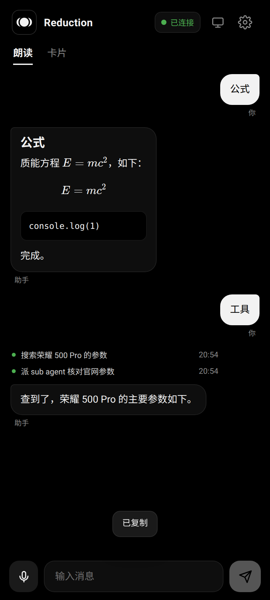
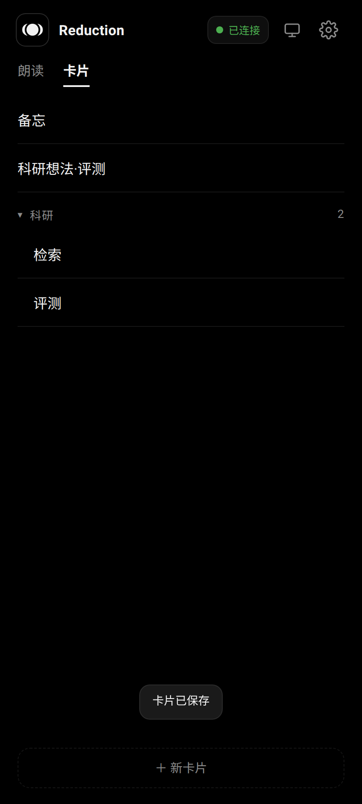

<p align="center">
  
</p>

<h1 align="center">Reduction-JARVIS for Everyone</h1>

[中文](README.md) · English

<p align="center">
  
  
  
  
</p>

Can we make everyday life easier while reliably directing more AI work?

Reduction's answer is yes. It aims to help people take in information and verify AI results as efficiently as possible.

A headset, phone, computer, and optional cloud relay share the work.

| | |
| :-- | :-- |
| **Headset and microphone** | Short real-time chats with the voice assistant, controlled by voice alone |
| **Phone** | Organizes tasks into cards. Keep the phone in your pocket, then review the cards together when you have time |
| **Computer** | Runs the subagents and provides the tools they can call |
| **Cloud server** | Relays messages between the phone and the computer around the clock. Subagents run on the computer |

<table>
  <tr>
    <td align="center" valign="bottom"></td>
    <td align="center" valign="bottom"></td>
    <td align="center" valign="bottom"></td>
    <td align="center" valign="bottom"></td>
  </tr>
  <tr>
    <td align="center"><sub>Startup animation</sub></td>
    <td align="center"><sub>Chat</sub></td>
    <td align="center"><sub>Cards</sub></td>
    <td align="center"><sub>Desktop pet on the computer</sub></td>
  </tr>
</table>

## Get started on Android

[Download Reduction for Android](https://ai.7-sunday.com/Reduction/). Version **1.0.81 (112)** moved the updater to HTTPS. If you have 1.0.80 or earlier, install the signed APK over your existing app once to keep your cards and settings. For later updates, open Settings and choose **检查并自动下载更新** (“Check for and automatically download updates”). The app verifies the download before handing it to the Android installer.

Try saying “Remind me on Friday to send the draft to Lin.” Later, review the reminder on your phone or open the related card on your computer. For spoken replies, Settings offers DeepSeek API voices and the Android system voice. To hear Chinese replies through the Android system voice, install an offline Chinese voice on the phone.

## What it can do

[**CARD · the Reduction card protocol**](docs/html-components.md) defines how to write CARD components (the building blocks of a card), with AI usage examples and the rules for attachments and export.

| | |
| :-- | :-- |
| **Screen-off voice control** | Say the wake word “Hi Reduction” to wake the assistant and “完毕” (*wánbì*, “finished”) to end the recording. Give it tasks while your phone stays in your pocket. |
| **Card-based memory** | A card is where you collect, organize, and revisit an everyday task or idea. The CARD protocol handles the underlying files. Use voice to direct the AI, edit the rendered result in place, and export a shareable file with private annotations removed. |
| **Coordinating agents** | The multi-agent design uses a super agent that works out what you want and delegates tasks. Sub agents carry out the work and report their results. |
| **Tool use** | Tool calling keeps growing: web search, a calculator, the status of other programming agent sessions on your computer, and low-battery alerts for the phone and headset |

### Cards and attachments

Drop an image between two paragraphs to insert it there. Documents such as Markdown, TXT, and CSV files are attached under their original names. The assistant can read Markdown and TXT attachments when it reads the card. The **Export** menu produces a full-length PNG, a PDF, or a ZIP containing the original files.

Cards inherit their sharing settings from the top-level folder. Cards under `个人/` (Personal) and `实验室/` (Lab) are private by default. Under `Reduction/`, you can write for a public audience and mark personal relationships or reminders as private annotations. The author can see those annotations. Public exports omit them.

### Manage GitHub by voice (desktop)

Ask “Refresh the GitHub repository activity card” to collect issues, pull requests, and releases in `Reduction/GitHub/仓库动态`. You can also ask Reduction to create or update an issue, post a comment, or publish the public version of a card to an HTML file in the repository. Writes use your GitHub CLI login in WSL (`gh auth login`). Reduction shows you the destination and content for confirmation before submitting.

## Set up the devices and services

[DeepSeek](https://platform.deepseek.com/) API key: provides the large language model (LLM), speech recognition and transcription (speech-to-text, ASR), text-to-speech (TTS), and web search services.

### Bluetooth headset

A headset with a microphone.

### Phone (Android 8.0 and later, arm64)

```bash
cp local.env.example local.env     # fill in the JDK 17 and Android SDK locations
tools/models/fetch-models.sh       # fetch the speech runtime and wake-word models (tens of MB, not committed)
./build.sh                         # produces dist/Reduction-v<version>.apk
```

Grant microphone access for background recording and permission to display overlays.

### Windows, WSL, and Linux desktops

Both desktop hosts serve the same card and chat interface. On **Windows**, the pet uses WebView2 and connects to a local Java backend. The [PowerShell installer](desktop/install-windows.ps1) takes the desktop distribution's library directory and a Windows Java 17 executable. The desktop shortcut and sign-in launcher then start the backend on Windows.

On **WSL or Linux**, build the desktop distribution with `./gradlew :desktop:installDist`, then run `desktop/open-panel.sh` in a graphical session. It starts the user service and opens the panel in Linux Chrome or Chromium.

### Cloud server

An optional relay lets the phone reach the computer over the internet. The computer merges changes from both devices.

### Pair your phone with a computer

Open the computer panel on your phone, add its SSH public key to the target account, and enter the host, port and username. Enable read-only analysis and choose a directory to let the assistant read files there and bring the results back to your conversation.

### How a delegated task finishes

A write task declares the files it intends to change. Reduction records an attempt before launch, checks for conflicts, and applies the configured directory permissions. If the launch acknowledgement is lost, the scheduler looks up that attempt by ID. A worker returns its commands, outputs, artifacts and a receipt. The task then enters pending review. An independent, read-only reviewer checks the artifacts against the original criteria and cites evidence from tool calls before the ledger marks the task complete.

The Android release and the deployed desktop have been tested for report delivery after a restart, duplicate requests, cancellation and retry checks.

## Where your data lives

Directory permissions govern what a subagent can read or change on that computer.

| | |
| :-- | :-- |
| **API key** | Stored only on your devices (encrypted on the phone; a file only you can read on the computer), and sent only to DeepSeek |
| **Conversations, cards, images, and recordings** | Once the phone and computer are connected, they can sync conversations, cards, to-dos, and missing card media. Each device keeps a local copy and stores its own settings. |
| **Sent to DeepSeek** | What you say (recordings are used for recognition), conversation content, and the text to be read aloud |
| **Sent to your own computer** | Only after you configure the computer connection: run logs and the recording of each of your turns, for troubleshooting and wake-word improvement. If you do not want to keep them, do not configure the computer connection |

## More

- [Development guide](docs/DEVELOPMENT.md): feature details, code structure, build, test, and release
- [Architecture diagram](docs/interaction-states-simple.png): the four layers of hardware, models, features, and UI, plus the voice state machine
- [Agent working principles](docs/agent-principles.md): how the super agent, sub agents, and people divide the work
- [Third-party components used](docs/THIRD_PARTY.md)

## License

[MIT license](LICENSE). The licenses of the third-party components used are listed [here](docs/THIRD_PARTY.md).
