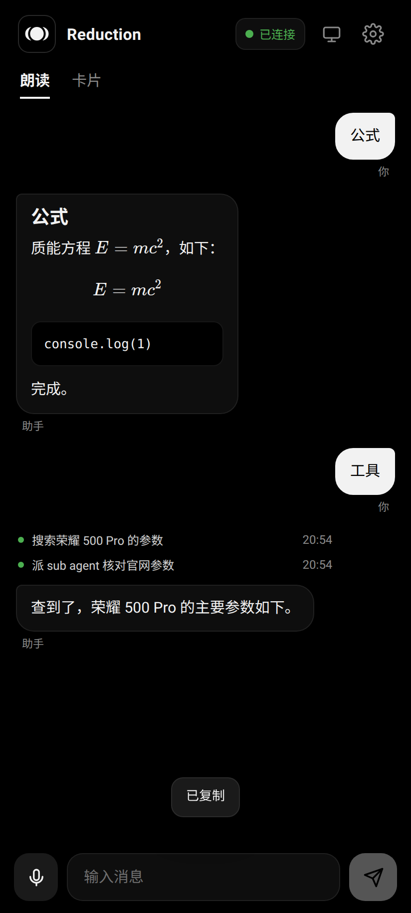
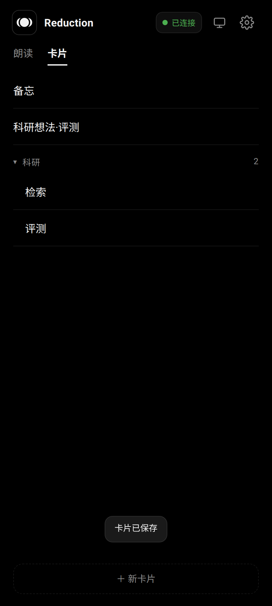
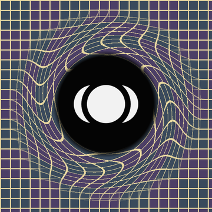

<p align="center">
  
</p>

<h1 align="center">Reduction-JARVIS for Everyone：智能随身助手</h1>

中文 · [English](README.en.md)

<p align="center">
  
  
  
  
</p>

Reduction回答一个问题：我们有可能轻松地、可靠地控制比从前多得多的智能吗？

回答是肯定的，Reduction致力于通过最大化信息效率，也就是人接受信息、验证AI结果的效率来达到这一点。

为此，Reduction提出了由随身设备、手机、电脑、云服务器协作完成的解决方案：

| | |
| :-- | :-- |
| **耳机和麦克风** | 实时简短的聊天，纯语音控制 |
| **手机** | 随身助手把事务归类、整理成卡片，平时可以不拿出手机，空闲时刻可以一次性审核 |
| **电脑** | 运行subagent，提供工具调用的接口 |
| **云服务器** | 24h常驻，在手机和电脑间转发消息，不运行subagent |

<table>
  <tr>
    <td align="center" valign="bottom"></td>
    <td align="center" valign="bottom"></td>
    <td align="center" valign="bottom"></td>
    <td align="center" valign="bottom"></td>
  </tr>
  <tr>
    <td align="center"><sub>启动动画</sub></td>
    <td align="center"><sub>对话</sub></td>
    <td align="center"><sub>卡片</sub></td>
    <td align="center"><sub>电脑上的桌宠</sub></td>
  </tr>
</table>

## 从手机开始，连接电脑、蓝牙耳机、你能想到的一切！

[下载 Reduction 安卓版](https://ai.7-sunday.com/Reduction/)

## 能做什么

[**CARD · Reduction 卡片协议**](docs/html-components.md) 包含组件写法、AI 调用示例、附件与导出约定。

| | |
| :-- | :-- |
| **熄屏语音交互** | 说 “Hi Reduction” 唤醒助手，说“完毕”结束录音，记录归纳任何需求和想法，不拿出手机做尽可能多的事情 |
| **卡片式记忆** | 用卡片重新组织你对日常事务的认知。一切皆卡片，卡片即整理。基于超级协议CARD屏蔽电脑的文件系统，用户直接AI+语音+少量手动编辑渲染结果，过滤隐私条目后交付脱敏的文件 |
| **多 agent 调度** | Reduction极大增强人控制agent的质量和数量AI，采用super agent-sub agent架构：super agent分发任务、理解意图；sub agent具体执行、反馈结果 |
| **工具使用** | 正在不断支持你能想到的一切：联网搜索、deepseek harness，查看电脑上其它编程 agent 会话的状态、手机和耳机电量提醒。 |

### 卡片与附件

把图片拖到卡片的两段文字之间，图片会插在落点。Markdown、TXT 和 CSV 等文档按原文件名挂载。读卡时助手可以读取 Markdown 和 TXT 正文。使用卡片上的「导出」菜单可生成 PNG 长图、PDF，或包含原件的 ZIP 包。

分享范围跟随一级文件夹。`个人/` 和 `实验室/` 默认整卡私密；`Reduction/` 适合写可分享的内容，夹在正文里的个人关系或备注可以标为私人标注。作者能看到标注，公开导出时会自动过滤。

### 用语音管理 GitHub（桌面端）

说“刷新 GitHub 仓库动态”，Reduction 会把本仓库的 Issues、PR 和 Releases 整理到「Reduction/GitHub/仓库动态」。也可以让它创建或更新 Issue、回复评论，或将指定卡片的公开版同步到仓库中的 HTML 文件。写入操作使用 WSL 的 GitHub CLI 登录态（`gh auth login`），提交前会显示目标和内容供你确认。

## 最小API方案

[DeepSeek](https://platform.deepseek.com/) API Key：提供全套视觉语言模型、语音文字互转、网络搜索服务

### 蓝牙耳机

拥有麦克风功能

### 手机（Android 8.0 及以上，arm64）

```bash
cp local.env.example local.env     # 填 JDK 17 和 Android SDK 的位置
tools/models/fetch-models.sh       # 取语音运行库和唤醒词模型（有几十 MB，不入库）
./build.sh                         # 得到 dist/Reduction-v<版本>.apk
```

需要授予录音机常驻、悬浮窗等较高权限

### Windows、WSL 与 Linux 桌面

两种桌面部署共用卡片和对话界面。**Windows** 桌宠通过 WebView2 连接本机 Java 后端。使用 [PowerShell 安装脚本](desktop/install-windows.ps1) 时，指定桌面发行包的库目录和 Windows Java 17 可执行文件。安装后，桌面快捷方式和登录自启均从 Windows 启动后端。

**WSL 或 Linux** 用户可先运行 `./gradlew :desktop:installDist` 构建桌面发行包，再在图形会话中运行 `desktop/open-panel.sh`。脚本会启动用户服务，并用 Linux 版 Chrome 或 Chromium 打开面板。

### 云服务器

可选的中转服务器让手机在外网也能连接到电脑。电脑负责合并两端的数据。

### 让手机读取电脑上的文件

在手机的电脑面板复制 SSH 公钥，加入目标账户，再填写主机、端口和用户名。开启只读分析并选择授权目录后，可以让助手读取其中的文件，把结果带回当前对话。

### 派出去的任务怎样才算完成

写任务先声明要改哪些文件。Reduction 在启动前记录尝试编号，检查冲突，并按目录配置读写权限。如果启动回执丢失，调度器按原编号找回任务。执行者交回命令、输出、产物和回执后，任务进入「待验收」；独立的只读核验者按原要求检查产物，引用工具证据后，台账才记为「完成」。

手机正式版和已部署桌面版已验证重启后重送报告、重复派发、取消和重试检查。

## 你的数据在哪

目录授权决定子助手可以在电脑上读取或修改哪些文件。

| | |
| :-- | :-- |
| **API Key** | 只存在你的设备上（手机上加密保存，电脑上是只有本人可读的文件），只发给 DeepSeek。 |
| **对话、卡片、图片和录音** | 配置手机与电脑的连接后，可以同步对话、卡片、待办和缺少的卡片媒体。每台设备保留本地副本；设置由各设备单独保存。 |
| **发给 DeepSeek 的** | 你说的话（录音用于识别）、对话内容、要朗读的文字。 |
| **发给你自己电脑的** | 仅在你配置了电脑连接之后：运行日志和你每一轮说话的录音，用于排查问题和改进唤醒。不想留就不要配置电脑连接。 |

## 更多

- [开发说明](docs/DEVELOPMENT.md)：功能细节、代码结构、构建、测试、发版
- [架构图](docs/interaction-states-simple.png)：硬件、模型、功能、界面四层，以及语音状态机
- [Agent 工作原则](docs/agent-principles.md)：super agent、sub agent 和人如何分工
- [用到的第三方组件](docs/THIRD_PARTY.md)

## 许可证

[MIT](LICENSE)。用到的第三方组件各自的许可证见[这里](docs/THIRD_PARTY.md)。
